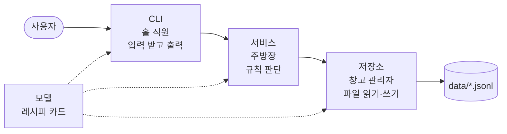

# 가계부 설계 노트

이 가계부를 **왜 이렇게 만들었는지** 쉽게 풀어 쓴 학습 자료입니다.
코드를 처음 보는 사람도 따라올 수 있도록 **비유 → 아주 작은 예제 → 우리 코드에서는** 순서로 설명합니다.

**읽는 순서**

1. [0단계: 먼저 알아둘 개념 5가지](#0단계-먼저-알아둘-개념-5가지): 이것만 이해하면 나머지는 쉽습니다.
2. [학습 목표 01~05](#학습-목표-01-파일에-저장하고-crud검색요약입출력-하기): 과제에서 설명할 수 있어야 하는 내용
3. [1분 요약](#1분-요약): 발표나 코드 리뷰 직전에 훑어보기

> 질문 옆의 ▶를 누르면 답이 펼쳐집니다. 파일 이름을 누르면 실제 소스 코드로 이동합니다.

---

## 0단계: 먼저 알아둘 개념 5가지

| 개념 | 한 줄 요약 | 해결하는 문제 |
| --- | --- | --- |
| [원자적 쓰기](#1-원자적-쓰기) | 임시 파일에 다 쓰고 이름만 바꿔 교체 | 쓰는 도중 프로그램이 죽으면 데이터가 날아가는 문제 |
| [제너레이터](#2-제너레이터) | `yield`로 값을 하나씩 만들어 넘겨줌 | 큰 파일을 통째로 읽어서 메모리가 부족해지는 문제 |
| [데코레이터](#3-데코레이터) | 함수를 감싸서 앞뒤에 기능을 덧붙임 | 같은 코드(오류 처리, 로그)를 여기저기 반복하는 문제 |
| [계층 구조](#4-계층-구조) | 일을 역할별로 나눠 맡김 | 한 파일에서 모든 일을 해서 고치기 어려운 문제 |
| [타입 힌트](#5-타입-힌트) | 함수가 무엇을 받고 돌려주는지 적어 둔 약속 | 코드를 읽는 사람이 함수 사용법을 추측해야 하는 문제 |

### 1. 원자적 쓰기

**한 줄 정의**: 파일을 **"전부 성공하거나, 아예 안 한 것처럼"** 바꾸는 방법입니다. 중간 상태가 남지 않습니다.

**비유**: 장부를 고칠 때 원본에 직접 지우개질하지 않습니다. **새 종이에 처음부터 끝까지 옮겨 적고, 다 쓰면 원본과 바꿔 끼웁니다.** 옮겨 적다가 펜이 부러져도 원본 장부는 멀쩡합니다.

**왜 필요한가**: 텍스트 파일은 중간의 한 줄만 고칠 수 없어서, 거래 1건을 수정하려 해도 파일 전체를 다시 써야 합니다.

```python
# 위험한 방법: 원본 파일에 바로 덮어쓰기
with open("transactions.jsonl", "w") as f:   # "w"로 여는 순간 기존 내용이 지워짐
    for tx in 거래들:
        f.write(...)                          # 500건째 쓰다가 전원이 꺼지면?
```

`"w"`로 여는 순간 원본은 이미 비워집니다. 1,000건 중 500건째를 쓰다가 프로그램이 죽으면 **나머지 500건은 영원히 사라집니다.**

**해결 방법**

```
1) .transactions.jsonl.tmp 에 전부 쓴다     ← 여기서 죽어도 원본은 멀쩡
2) fsync: 디스크에 확실히 기록될 때까지 기다린다
3) os.replace(tmp, 원본)                    ← 이름만 바꾸므로 '한 순간'에 교체
```

`os.replace`는 같은 폴더 안에서 내용을 복사하지 않고 **이름표만 바꿔 다는 작업**이라 "반쯤 바뀐" 상태가 존재하지 않습니다. 그래서 언제 죽더라도 결과는 둘 중 하나입니다.

- 교체 **전**에 죽음 → 원본 그대로
- 교체 **후**에 죽음 → 새 내용 완성본

**우리 코드에서는**: [`storage/atomic.py`](../budget_app/storage/atomic.py)의 `atomic_write`. update, delete, import, 카테고리 대체, 예산 설정, export에서 씁니다. `add`는 파일 끝에 한 줄만 덧붙이면 되므로 원자적 쓰기 대신 append를 씁니다.

### 2. 제너레이터

**한 줄 정의**: 값을 **한꺼번에 다 만들어 두지 않고, 요청할 때마다 하나씩 만들어 주는 함수**입니다. `return` 대신 `yield`를 씁니다.

**비유**

- **리스트는 뷔페**입니다. 음식 100접시를 미리 다 차려 놓아서 공간(메모리)을 많이 차지합니다.
- **제너레이터는 회전초밥**입니다. 한 접시씩 나오고, 다 먹으면 다음 접시가 나옵니다. 테이블에는 늘 한 접시만 있습니다.

**아주 작은 예제**

```python
def 숫자_만들기():
    print("1 만드는 중")
    yield 1          # 여기서 1을 넘겨주고 '멈춤'
    print("2 만드는 중")
    yield 2          # 다음 요청이 오면 여기까지 실행하고 또 멈춤

gen = 숫자_만들기()   # 아직 아무것도 실행 안 됨! (print 안 찍힘)
next(gen)            # "1 만드는 중" 출력 → 1 반환
next(gen)            # "2 만드는 중" 출력 → 2 반환
```

핵심은 **`yield`에서 함수가 멈춘 채로 기다린다**는 점입니다. 일반 함수는 `return`하면 끝나지만, 제너레이터는 멈춘 위치와 변수 값을 기억했다가 다음 요청이 오면 그 자리부터 이어서 실행합니다.

**파일 읽기에 쓰면**

```python
# 리스트 방식: 100만 줄을 전부 메모리에 올림
def 전부_읽기():
    return open("transactions.jsonl").readlines()

# 제너레이터 방식: 한 줄 읽어 넘겨주고, 다음 요청 때 다음 줄을 읽음
def 한줄씩_읽기():
    with open("transactions.jsonl") as f:
        for line in f:
            yield json.loads(line)
```

거래가 10건이든 100만 건이든 메모리에는 **지금 처리 중인 한 줄**만 있습니다.

**주의할 점**

- **한 번만 쓸 수 있습니다.** 끝까지 돌고 나면 비어 있으므로, 다시 돌리려면 함수를 다시 호출해야 합니다.
- `gen[3]` 같은 인덱스 접근이나 `len()`이 안 됩니다.

**우리 코드에서는**: [`storage/jsonl.py`](../budget_app/storage/jsonl.py)의 `_numbered`, `load`와 [`storage/transactions.py`](../budget_app/storage/transactions.py)의 `iter_all`. 자세한 내용은 [학습 목표 03](#학습-목표-03-yield-제너레이터로-큰-파일-처리하기)에 있습니다.

### 3. 데코레이터

**한 줄 정의**: **기존 함수를 고치지 않고 앞뒤에 기능을 덧붙여 주는 포장지**입니다. 함수 위에 `@이름`을 붙여서 씁니다.

**비유**: 선물(원래 함수)은 그대로 두고 **포장지**를 씌웁니다. "실행 시간 재기" 포장지, "오류 처리" 포장지를 겹겹이 씌울 수 있고, 같은 포장지를 다른 선물에도 그대로 쓸 수 있습니다.

**정체는 "함수를 받아서 함수를 돌려주는 함수"**

```python
import time

def timed(func):                      # 1) 원래 함수를 받아서
    def wrapper(*args, **kwargs):     # 2) 앞뒤에 기능을 붙인 새 함수를 만들고
        start = time.perf_counter()
        result = func(*args, **kwargs)        # 원래 함수 실행
        print(f"{func.__name__}: {time.perf_counter() - start:.3f}초")
        return result
    return wrapper                    # 3) 그 새 함수를 돌려준다

@timed                    # 이 한 줄은
def 요약하기():           # 요약하기 = timed(요약하기) 와 완전히 같은 뜻
    ...
```

`@timed`는 문법을 편하게 만든 것일 뿐입니다. 실제로 하는 일은 `요약하기 = timed(요약하기)`이고, 이름은 그대로인데 내용물이 "시간 재는 포장이 씌워진 함수"로 바뀝니다.

**왜 쓰나**: 명령이 12개인데 데코레이터가 없으면 12개 함수마다 똑같은 코드를 넣어야 합니다. 그러면 진짜 할 일이 반복 코드에 묻혀 보이지 않고, 오류 메시지 형식 하나를 바꾸려 해도 12군데를 고쳐야 합니다.

**우리 코드에서는**: [`decorators.py`](../budget_app/decorators.py)에 3개(`handle_errors`, `log_execution`, `timed`)를 만들어 [`cli/app.py`](../budget_app/cli/app.py)의 `run_command` 한 곳에 붙였습니다. 이것만으로 12개 명령 전체에 적용됩니다. 자세한 내용은 [학습 목표 04](#학습-목표-04-데코레이터로-공통-작업-분리하기)에 있습니다.

### 4. 계층 구조

**비유: 식당**

| 식당 | 우리 프로그램 | 하는 일 |
| --- | --- | --- |
| 홀 직원 | **CLI** | 손님(사용자)의 주문을 받고 음식(결과)을 가져다줌 |
| 주방장 | **서비스** | "이 재료로 이 요리가 되나?" 같은 판단과 조리 |
| 창고 관리자 | **저장소** | 재료(데이터)를 창고(파일)에 넣고 꺼냄 |
| 레시피 카드 | **모델** | 요리(데이터)가 어떤 모양인지 모두가 같이 보는 기준 |

홀 직원은 창고에 직접 들어가지 않고, 창고 관리자는 손님과 대화하지 않습니다. 각자 자기 일만 하니까 **창고 위치를 옮겨도(저장 형식을 바꿔도) 홀 직원은 몰라도 됩니다.**

### 5. 타입 힌트

**한 줄 정의**: 함수가 **무엇을 받고 무엇을 돌려주는지** 코드에 적어 둔 약속입니다.

```python
def 금액_합계(금액들: list[int]) -> int:   # 정수 리스트를 받아 정수를 돌려준다
    return sum(금액들)
```

**비유**: 콘센트 모양입니다. 모양만 봐도 어떤 플러그가 맞는지 알 수 있습니다. 다만 파이썬은 **실행할 때 이 약속을 강제로 검사하지 않습니다.** 모양이 맞지 않는 플러그를 억지로 꽂는 것을 막아주는 건 IDE나 mypy 같은 검사 도구입니다.

---

## 학습 목표 01. 파일에 저장하고 CRUD·검색·요약·입출력 하기

> 파일 기반 저장(JSONL/CSV)으로 데이터를 영구 저장하고, CRUD/검색/요약/입출력을 구현할 수 있다.

### 쉬운 말로

데이터는 **JSONL** 파일에 저장합니다. JSONL은 "한 줄 = JSON 하나"인 형식입니다.

```text
{"id": "TX-000001", "type": "expense", "date": "2024-01-15", "amount": 15000, "category": "food", "memo": "점심", "tags": ["meal"]}
{"id": "TX-000002", "type": "income", "date": "2024-01-14", "amount": 3000000, "category": "salary", "memo": "", "tags": []}
```

한 줄이 거래 하나라서 **끝에 한 줄 붙이기(추가)**와 **한 줄씩 읽기(조회)**가 아주 쉽습니다. 파일은 `transactions`(거래) / `categories`(카테고리) / `budgets`(예산) 3개로 나눴습니다. 예산 하나를 바꿀 때 큰 거래 파일까지 다시 쓰지 않아도 됩니다.

### 우리 코드에서는

| 하고 싶은 일 | 명령 | 파일을 어떻게 다루나 |
| --- | --- | --- |
| 추가 (Create) | `add` | 파일 **끝에 한 줄 붙이기**. 기존 내용은 안 건드림 |
| 조회 (Read) | `list`, `search` | **한 줄씩** 읽기 ([제너레이터](#2-제너레이터)) |
| 수정 (Update) | `update` | 임시 파일에 전체를 다시 쓰고 **이름만 바꿔 교체** ([원자적 쓰기](#1-원자적-쓰기)) |
| 삭제 (Delete) | `delete` | 지울 줄만 빼고 임시 파일에 쓴 뒤 교체 |
| 요약 | `summary` | 한 줄씩 읽으며 **합계만** 더함. 거래를 쌓아 두지 않음 |
| 가져오기 | `import` | 원본 + 새 거래를 임시 파일에 한 번에 쓰고 교체. 전부 반영되거나 하나도 반영되지 않음 |
| 내보내기 | `export` | CSV 파일도 원자적 쓰기로 저장 |

### 30초 안에 말하기

> "거래 한 건을 JSON 한 줄로 저장하는 JSONL 파일을 썼습니다. 추가는 파일 끝에 한 줄을 붙이고, 수정·삭제는 임시 파일에 새로 쓴 다음 이름만 바꿔서 교체합니다. 그래서 도중에 프로그램이 죽어도 원본이 망가지지 않습니다. 검색과 요약은 파일을 한 줄씩 읽으면서 처리합니다."

### 예상 질문

<details>
<summary><b>Q.</b> add는 끝에 붙이기만 하는데, update는 왜 파일 전체를 다시 쓰나요?</summary>

텍스트 파일은 중간의 한 줄만 길이를 바꿔 고쳐 쓸 수 없습니다. 금액이 `15000`(5글자)에서 `180000`(6글자)으로 바뀌면 그 뒤 내용이 한 칸씩 전부 밀립니다. 그래서 수정·삭제는 새로 쓸 수밖에 없고, add는 끝에 붙이기만 하면 되니 가장 간단한 방법을 씁니다.
</details>

<details>
<summary><b>Q.</b> 삭제한 거래의 id가 다시 쓰이지는 않나요?</summary>

마지막으로 발급한 번호를 `transactions.seq` 파일에 따로 적어 둡니다. 가장 최근 거래(예: TX-000010)를 지워도 다음 거래는 TX-000011이 됩니다.
</details>

<details>
<summary><b>Q.</b> 파일 내용이 망가지면 어떻게 되나요?</summary>

프로그램이 멈추지 않고 "transactions.jsonl **6번째 줄**이 손상되었습니다"처럼 위치를 알려주고, `backup restore`로 복구하라는 힌트를 보여줍니다(종료 코드 5).
</details>

---

## 학습 목표 02. 모델 · 저장소 · 서비스 · CLI로 역할 나누기

> 콘솔 프로그램을 클래스/모듈로 구조화하고, 각 계층(모델/저장소/서비스/CLI)의 책임을 설명할 수 있다.

### 쉬운 말로

[0단계의 식당 비유](#4-계층-구조)를 그대로 코드로 옮겼습니다.



| 계층 | 하는 일 | 절대 안 하는 일 | 예시 파일 |
| --- | --- | --- | --- |
| 모델 | 데이터 모양 정하기 (`Transaction` 등) | 파일 읽기, 화면 출력 | [`models.py`](../budget_app/models.py) |
| 저장소 | 파일 읽기·쓰기, id 발급 | "이 카테고리가 있나?" 같은 판단 | [`storage/transactions.py`](../budget_app/storage/transactions.py) |
| 서비스 | 규칙 판단 (없는 id, 예산 초과 등) | `input()`, `print()` | [`services/transaction_service.py`](../budget_app/services/transaction_service.py) |
| CLI | 옵션 읽기, 질문하기, 표 그리기 | 파일 형식 알기 | [`cli/commands/delete.py`](../budget_app/cli/commands/delete.py) |

### 우리 코드에서는: `delete --id TX-000003`을 따라가 보기

1. **CLI(홀 직원)**: "TX-000003 지워 주세요"라는 주문을 받아 서비스에 전달합니다.
2. **서비스(주방장)**: "그런 거래가 있나?" 확인합니다. 없으면 "없는 데이터"라고 알리고, 있으면 저장소에 삭제를 맡깁니다.
3. **저장소(창고 관리자)**: 그 거래만 빼고 임시 파일에 쓴 뒤 교체합니다.
4. **CLI(홀 직원)**: "삭제 완료"를 화면에 보여줍니다.

```python
# services/transaction_service.py
def delete(self, tx_id: str) -> Transaction:
    tx = self.get(tx_id)          # 판단: 없으면 "없는 데이터" 오류 (주방장의 일)
    self.repo.delete(tx.id)       # 파일 작업은 저장소에 맡김 (창고 관리자의 일)
    return tx                     # 출력은 CLI가 함 (홀 직원의 일)
```

### 30초 안에 말하기

> "CLI는 입력과 출력만, 서비스는 규칙 판단만, 저장소는 파일 읽기·쓰기만 합니다. 서로 할 일이 겹치지 않아서 저장 형식을 바꿔도 저장소만 고치면 되고, 서비스에는 print가 없어서 화면 없이도 테스트할 수 있습니다."

### 예상 질문

<details>
<summary><b>Q.</b> 서비스에서 print를 쓰면 안 되나요?</summary>

쓰면 서비스가 "콘솔 화면"에 묶여 버립니다. 결과만 돌려주면 같은 서비스를 콘솔, 테스트 코드, 나중에 만들 웹 화면이 모두 그대로 쓸 수 있습니다.
</details>

<details>
<summary><b>Q.</b> <code>context.py</code>는 무슨 역할인가요?</summary>

식당으로 치면 **개업 준비 담당**입니다. 창고(데이터 폴더)를 열고, 창고 관리자(저장소)와 주방장(서비스)을 채용해서 서로 연결해 줍니다. 그래서 각 서비스는 저장소를 직접 만들지 않고 받아서 쓰기만 합니다.
</details>

<details>
<summary><b>Q.</b> 명령마다 파일을 나눈 이유는요?</summary>

`add`를 고칠 때 `delete` 코드를 건드릴 일이 없게 하려고 나눴습니다. 새 명령을 추가할 때도 파일 하나를 만들고 목록에 한 줄만 추가하면 됩니다.
</details>

---

## 학습 목표 03. yield 제너레이터로 큰 파일 처리하기

> `yield` 기반 제너레이터로 대용량 파일도 스트리밍 처리하는 이유와 동작 방식을 설명할 수 있다.

### 쉬운 말로

[0단계의 회전초밥 비유](#2-제너레이터)를 기억하면 됩니다. 파일을 **한 줄 읽어 넘겨주고 → 멈추고 → 다음 요청이 오면 다음 줄을 읽습니다.** 거래가 100만 건이어도 메모리에는 한 줄만 있습니다.

### 우리 코드에서는: 4개의 회전초밥 레일을 이어 붙임

`list --limit 10`을 실행하면 거래 하나가 아래 레일을 차례로 지나갑니다. 리스트를 만들지 않고 **한 건씩** 다음 단계로 넘어갑니다.


```python
# storage/jsonl.py: ① 한 줄 읽기
def _numbered(self):
    with self.path.open("r", encoding="utf-8") as fh:
        for line_no, line in enumerate(fh, start=1):   # 파일도 한 줄씩 읽힘
            record = json.loads(line)
            yield line_no, record   # 한 건 넘겨주고 여기서 멈춤
```

④의 `heapq.nlargest(10, ...)`는 **"지금까지 본 것 중 최신 10개"만 손에 쥐고 있는** 도구입니다. 새 거래가 들어오면 10개 중 가장 오래된 것보다 최신일 때만 바꿔 넣습니다.

| 방식 | 거래 10만 건일 때 메모리에 있는 것 |
| --- | --- |
| `readlines()`로 전부 읽고 정렬 | 거래 **100,000개** |
| 제너레이터 + `heapq.nlargest(10, …)` | 지금 읽는 1줄 + 최신 10건 = 약 **11개** |

이 동작은 테스트 [`tests/test_core.py`](../tests/test_core.py)에서 실제로 10만 건을 흘려보내 확인합니다.

### 30초 안에 말하기

> "`yield`가 있는 함수는 값을 하나 넘겨주고 그 자리에서 멈췄다가, 다음 요청이 오면 이어서 실행합니다. 이걸로 파일을 한 줄씩 읽어서, 거래가 아무리 많아도 메모리에는 한 줄만 올라가게 했습니다. 목록 조회는 최신 N건만 들고 있는 `heapq.nlargest`와 연결해서 N건만 유지합니다."

### 예상 질문

<details>
<summary><b>Q.</b> search 결과를 정렬하려면 결국 전부 메모리에 올려야 하지 않나요?</summary>

**조건에 맞는 거래만** 올라갑니다. 파일 전체가 아닙니다. `--limit`을 주면 그마저도 N건으로 줄어듭니다. 정렬이 필요 없는 `summary`는 거래를 아예 쌓지 않고 합계만 더합니다.
</details>

<details>
<summary><b>Q.</b> 제너레이터 대신 그냥 리스트를 쓰면 안 되나요?</summary>

데이터가 작으면 차이가 거의 없습니다. 하지만 가계부는 매일 쌓여서 몇 년이 지나면 커집니다. 처음부터 제너레이터로 만들어 두면 나중에 데이터가 커져도 코드를 고칠 필요가 없습니다. 반대로 카테고리 목록처럼 항상 작은 데이터는 일부러 리스트로 돌려줍니다.
</details>

<details>
<summary><b>Q.</b> 제너레이터를 쓸 때 조심할 점은요?</summary>

**한 번만 돌릴 수 있습니다.** 끝까지 돌고 나면 비어 있습니다. 그리고 `with open(...)` 안에서 `yield`하면 끝까지 다 읽어야 파일이 닫힙니다. 그래서 수정·삭제할 때는 원본을 끝까지 다 읽은 **다음에** 파일을 교체합니다(Windows는 열려 있는 파일을 교체할 수 없습니다).
</details>

---

## 학습 목표 04. 데코레이터로 공통 작업 분리하기

> 데코레이터로 공통 관심사(로그/예외/시간 측정)를 분리한 구조와 이유를 설명할 수 있다.

### 쉬운 말로

[0단계의 포장지 비유](#3-데코레이터)처럼, 모든 명령에 필요한 3가지 일을 **포장지 3장**으로 만들었습니다.

| 포장지 | 하는 일 |
| --- | --- |
| `@handle_errors` | 오류가 나면 `[오류] 원인` + `[힌트] 해결 방법`을 보여주고 종료 코드를 정함 |
| `@log_execution` | "시작 / 끝 / 실패"를 로그 파일(`app.log`)에 기록 |
| `@timed` | 얼마나 걸렸는지 재서 기록 |

### 데코레이터가 없을 때 vs 있을 때

**없으면** 12개 명령마다 이런 코드를 반복해야 합니다.

```python
def run_delete(args):
    start = time.perf_counter()        # 시간 재기
    logger.info("시작 delete")          # 로그
    try:
        ...진짜 할 일은 이 한 줄...
    except NotFoundError as e:         # 오류 처리
        print("[오류]", e.message)
        return 3
    finally:
        logger.info(time.perf_counter() - start)
# add, list, search ... 12번 반복
```

**있으면** 한 곳에만 붙이면 끝입니다. [`cli/app.py`](../budget_app/cli/app.py)

```python
@handle_errors     # 3번째(가장 바깥) 포장지: 오류 → [오류]/[힌트]
@log_execution     # 2번째 포장지: 시작/끝/실패 기록
@timed             # 1번째(가장 안쪽) 포장지: 시간 재기
def run_command(args) -> int:
    ...모든 명령이 이 함수를 거쳐 실행됨...
```

### 포장지를 씌우는 순서가 중요한 이유

포장지는 **아래에서 위로** 씌워집니다. 오류가 나면 안쪽 포장지부터 차례로 지나갑니다.

1. `timed`(안쪽): 오류가 나도 걸린 시간은 기록합니다.
2. `log_execution`(가운데): "실패했다"고 기록한 뒤 오류를 **다시 바깥으로 넘깁니다.**
3. `handle_errors`(바깥): 마지막에 오류를 받아 사용자에게 보기 좋은 메시지로 바꿉니다.

순서를 거꾸로 하면 `handle_errors`가 먼저 오류를 처리해 버려서 `log_execution`은 실패를 기록하지 못합니다.

### 한 번 만들어서 여러 곳에 재사용

`@timed`는 명령 전체뿐 아니라 파일 다시 쓰기, 월 요약, CSV 입출력, 백업에도 붙어 있습니다. `--verbose` 옵션을 주면 화면에서도 볼 수 있습니다.

```text
[로그] 실행 시간: JsonlFile.rewrite 3.30ms
```

> **실제로 겪은 버그**: 처음에는 특정 상황에서 오류 내용(스택트레이스)이 화면에 그대로 찍혔습니다. "스택트레이스 출력 금지" 요구사항 위반이었습니다. 오류 처리가 데코레이터 한 곳에 모여 있어서 **[`decorators.py`](../budget_app/decorators.py) 파일 하나만 고쳐서** 12개 명령 모두 해결했습니다.

### 30초 안에 말하기

> "오류 처리, 로그, 시간 측정은 모든 명령에 필요한 공통 작업이라서 각 명령에 복사하지 않고 데코레이터 3개로 만들었습니다. 명령을 실행하는 함수 한 곳에 붙여서 12개 명령 전체에 적용했고, 덕분에 명령 코드에는 진짜 할 일만 남았습니다. 오류 메시지 형식을 바꿀 때도 한 곳만 고치면 됩니다."

### 예상 질문

<details>
<summary><b>Q.</b> 데코레이터 안의 <code>@functools.wraps(func)</code>는 왜 붙이나요?</summary>

이게 없으면 포장된 함수의 이름이 전부 `wrapper`로 바뀝니다. 그러면 로그에 "실행 시간: wrapper"라고 찍혀서 어떤 함수였는지 알 수 없습니다. `wraps`가 원래 이름표를 옮겨 붙여 줍니다.
</details>

<details>
<summary><b>Q.</b> 오류 처리(try/except)를 서비스 안에 넣으면 안 되나요?</summary>

서비스는 "무엇이 잘못됐는지"만 오류로 알립니다(예: "없는 데이터"). 그 오류를 화면에 어떻게 보여주고 종료 코드를 몇으로 할지는 **콘솔 프로그램만의 사정**이라서 CLI 바깥의 데코레이터가 맡습니다.
</details>

---

## 학습 목표 05. 타입 힌트로 약속을 분명하게 하기

> 타입 힌트를 통해 입출력 계약을 명확히 했을 때 얻는 이점을 실제 코드 예로 설명할 수 있다.

### 쉬운 말로

타입 힌트는 함수의 **사용 설명서를 함수 이름 옆에 붙여 둔 것**입니다. 문서를 따로 찾아보지 않아도 무엇을 넣고 무엇을 받는지 바로 보입니다. ([0단계 설명](#5-타입-힌트))

### 우리 코드의 예시 4가지

**① "없어도 된다"를 표시하기: `X | None`**

```python
# models.py: update 할 때 바꿀 항목만 담는 상자
class TransactionPatch:
    amount: int | None = None    # None = "금액은 안 바꿈"
    memo: str | None = None      # None = "메모는 안 바꿈", "" = "메모를 지움"
```

"옵션을 안 줬다(`None`)"와 "빈 값으로 바꿔라(`""`)"가 타입만 보고도 구분됩니다.

**② 무엇을 돌려주는지 표시하기**

```python
# services/transaction_service.py
def update(self, tx_id: str, patch: TransactionPatch) -> tuple[Transaction, Transaction]:
    """(수정 전, 수정 후)를 반환한다."""
```

반환 타입을 보면 `before, after = service.update(...)`처럼 두 개로 나눠 받으면 된다는 것을 알 수 있습니다.

**③ "한 줄씩 흘려준다"를 표시하기: `Iterator`**

```python
# storage/transactions.py
def iter_all(self) -> Iterator[Transaction]: ...
```

`list`가 아니라 `Iterator`라고 적어서 "[제너레이터](#2-제너레이터)라 한 번만 돌릴 수 있다"는 사실을 알려줍니다.

**④ 모든 명령의 공통 약속**

```python
# cli/base.py: 모든 명령 함수는 이 모양이어야 함
Handler = Callable[[argparse.Namespace, AppContext], int]
#                  (옵션들,           앱 정보)  → 종료 코드(정수)
```

"모든 명령은 종료 코드(정수)를 돌려준다"는 규칙이 코드에 적혀 있습니다.

### 얻는 이점

| 이점 | 예 |
| --- | --- |
| 읽는 사람이 바로 이해함 | `limit: int \| None`을 보면 "제한 없음도 된다"는 걸 앎 |
| 실수를 실행 전에 발견 | IDE나 mypy가 "여기 정수 자리에 문자열을 넣었다"고 경고 |
| 자동완성 | `tx.`까지 치면 IDE가 `amount`, `category` 등을 보여줌 |
| 고치기 안전함 | `Transaction`에 필드를 추가하면 영향받는 곳을 IDE가 찾아줌 |

### 30초 안에 말하기

> "타입 힌트는 함수가 무엇을 받고 돌려주는지 적어 둔 약속입니다. 예를 들어 update 옵션을 `int | None`으로 적어서 '안 바꿈'과 '빈 값으로 바꿈'을 구분했고, `Iterator`로 적어서 한 번만 돌 수 있다는 걸 알렸습니다. 덕분에 코드를 읽기 쉽고, 검사 도구가 실수를 미리 잡아줍니다. 다만 실행 중에는 검사하지 않으므로 사용자 입력은 따로 검증합니다."

### 예상 질문

<details>
<summary><b>Q.</b> 타입 힌트를 적으면 잘못된 입력이 자동으로 막히나요?</summary>

**아닙니다.** 파이썬은 실행할 때 타입 힌트를 검사하지 않습니다. 사용자가 입력한 `-500`이나 `2024-13-40`은 [`validators.py`](../budget_app/validators.py)가 직접 검사합니다.

- 타입 힌트 = **개발자끼리의 약속**
- 입력 검증 = **사용자 입력에 대한 방어**

둘은 역할이 다릅니다.
</details>

<details>
<summary><b>Q.</b> 모든 파일 맨 위의 <code>from __future__ import annotations</code>는 뭔가요?</summary>

타입 힌트를 실행 시점에 바로 해석하지 않고 글자 그대로 보관하라는 뜻입니다. 덕분에 아직 아래쪽에 정의되지 않은 클래스 이름도 힌트에 미리 쓸 수 있습니다.
</details>

---

## 1분 요약

| 주제 | 기억할 것 |
| --- | --- |
| **원자적 쓰기** | 새 종이에 다 옮겨 적고 바꿔 끼우기. 임시 파일 → fsync → `os.replace`. 도중에 죽어도 원본은 안전. |
| **제너레이터** | 회전초밥. `yield`에서 멈췄다가 이어서 실행. 메모리에는 한 줄만. |
| **데코레이터** | 포장지. 함수를 고치지 않고 앞뒤에 기능 추가. `@timed` = `f = timed(f)`. |
| **01 저장** | JSONL 1줄 = 거래 1건. 추가는 끝에 붙이기, 수정·삭제·가져오기는 원자적 쓰기. 파일 3개로 분리. |
| **02 계층** | 식당. CLI(홀) → 서비스(주방) → 저장소(창고). 모델은 레시피 카드. 서비스에 print 없음. |
| **03 제너레이터** | 읽기 → 변환 → 필터 → 최신 N건, 네 레일을 이어 붙임. 10만 건도 메모리 약 11개. |
| **04 데코레이터** | 오류 처리·로그·시간 측정 3장. 한 곳에 붙여 12개 명령에 적용. 순서: 바깥 = 오류 처리. |
| **05 타입 힌트** | 함수 옆의 사용 설명서. `int \| None` = 없어도 됨, `Iterator` = 한 번만. 실행 중 검사는 안 함. |
