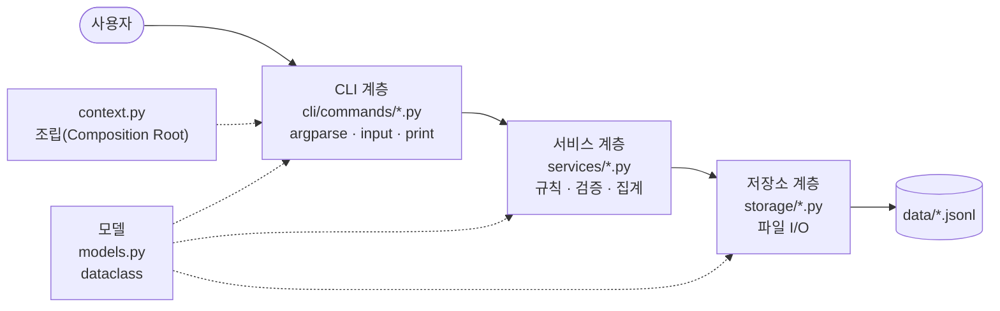

# 가계부 설계 노트

이 가계부 프로젝트를 **왜 이렇게 만들었는지** 실제 코드로 설명하는 학습 자료입니다.
학습 목표마다 30초 안에 말할 수 있는 답을 먼저 두고, 근거가 되는 코드와 동작 흐름, 리뷰에서 나올 만한 질문을 차례로 정리했습니다.

| # | 학습 목표 |
| --- | --- |
| [01](#01-파일-기반-저장으로-crud검색요약입출력-구현) | 파일 기반 저장(JSONL/CSV)으로 데이터를 영구 저장하고, CRUD/검색/요약/입출력을 구현할 수 있다. |
| [02](#02-모델--저장소--서비스--cli-계층별-책임) | 콘솔 프로그램을 클래스/모듈로 구조화하고, 각 계층(모델/저장소/서비스/CLI)의 책임을 설명할 수 있다. |
| [03](#03-yield-제너레이터로-대용량-파일-스트리밍) | `yield` 기반 제너레이터로 대용량 파일도 스트리밍 처리하는 이유와 동작 방식을 설명할 수 있다. |
| [04](#04-데코레이터로-로그--예외--시간-측정-분리) | 데코레이터로 공통 관심사(로그/예외/시간 측정)를 분리한 구조와 이유를 설명할 수 있다. |
| [05](#05-타입-힌트로-입출력-계약-명확히-하기) | 타입 힌트를 통해 입출력 계약을 명확히 했을 때 얻는 이점을 실제 코드 예로 설명할 수 있다. |

> 맨 아래에 발표·리뷰 직전에 훑어볼 [1분 요약](#1분-요약)이 있습니다. 질문(▶)을 누르면 답이 펼쳐집니다.

---

## 01. 파일 기반 저장으로 CRUD·검색·요약·입출력 구현

> **30초 답변**
> 거래 1건을 JSON 한 줄로 저장하는 JSONL 파일을 씁니다. 추가는 파일 끝에 한 줄을 덧붙이고, 수정·삭제는 원본을 한 줄씩 읽으며 임시 파일에 새로 쓴 다음 `os.replace`로 통째로 바꿉니다. 검색과 요약은 파일을 한 줄씩 흘려보내며 걸러내거나 합계만 누적하고, CSV 입출력은 사용자 입력과 같은 검증 함수를 그대로 다시 씁니다.

### 작업별로 파일을 다루는 방식

| 작업 | 명령 | 담당 메서드 | 파일 처리 |
| --- | --- | --- | --- |
| Create | `add` | `TransactionRepository.add` | 끝에 한 줄 append 후 `fsync`. 기존 데이터는 건드리지 않음 |
| Read | `list`, `search` | `iter_all` | 한 줄씩 읽어 `yield` |
| Update | `update` | `replace` | 임시 파일에 전체를 다시 쓴 뒤 원자적 교체 |
| Delete | `delete` | `delete` | 해당 id만 빼고 임시 파일에 쓴 뒤 교체 |
| 요약 | `summary` | `ReportService.monthly_summary` | 거래를 쌓아 두지 않고 합계와 카테고리별 `Counter`만 누적 |
| 가져오기 | `import` | `add_many` | 원본 + 새 행을 임시 파일에 한 번에 쓰고 교체(전부 반영 아니면 전부 미반영) |
| 내보내기 | `export` | `CsvTransferService.export` | CSV도 `atomic_write`로 작성 |

### 핵심 코드: 원자적 쓰기

[`budget_app/storage/atomic.py`](../budget_app/storage/atomic.py)

```python
@contextmanager
def atomic_write(path: Path, *, newline: str | None = "\n") -> Iterator[TextIO]:
    path.parent.mkdir(parents=True, exist_ok=True)
    fd, tmp_name = tempfile.mkstemp(prefix=f".{path.name}.", suffix=".tmp", dir=path.parent)
    tmp_path = Path(tmp_name)
    try:
        with os.fdopen(fd, "w", encoding="utf-8", newline=newline) as fh:
            yield fh
            fh.flush()
            os.fsync(fh.fileno())          # 디스크에 실제로 기록될 때까지 대기
        os.replace(tmp_path, path)          # 이름 바꾸기 = 한 번에 교체
    except BaseException:
        with suppress(FileNotFoundError):
            tmp_path.unlink()               # 실패하면 임시 파일만 지우고 원본은 그대로
        raise
```

임시 파일을 **같은 폴더**에 만드는 데 이유가 있습니다. 같은 디스크 안에서 `os.replace`는 파일 내용을 복사하지 않고 이름만 바꾸기 때문에, 중간 상태 없이 한 번에 교체됩니다. 그래서 쓰는 도중 오류가 나거나 전원이 꺼져도 원본은 이전 상태 그대로 남습니다. 이 동작은 [`tests/test_core.py`](../tests/test_core.py)의 `AtomicRewriteTest`가 일부러 중간에 예외를 내서 확인합니다.

### JSONL을 고른 이유

한 줄이 곧 레코드 하나라서 **append**와 **한 줄씩 읽기**가 자연스럽습니다. `tags` 같은 리스트도 그대로 저장되고, 한 줄이 깨지면 "transactions.jsonl 6번째 줄"처럼 위치를 정확히 알려줄 수 있습니다.
파일은 `transactions` / `categories` / `budgets`로 나눴습니다. 거래가 아무리 많아도 예산이나 카테고리 하나를 바꿀 때 큰 거래 파일을 다시 쓰지 않아도 됩니다.

### 예상 질문

<details>
<summary><b>Q.</b> add는 append인데 update는 왜 파일 전체를 다시 쓰나요?</summary>

텍스트 파일은 중간의 한 줄만 길이를 바꿔 고쳐 쓸 수 없습니다. 금액이 `15000`에서 `180000`으로 바뀌면 그 뒤 내용이 전부 밀립니다. 그래서 수정·삭제는 "원본을 읽으며 새 파일에 쓰고 교체"할 수밖에 없고, add는 끝에 붙이기만 하면 되니 가장 싼 방법을 씁니다.
</details>

<details>
<summary><b>Q.</b> 삭제한 id가 다시 발급되지는 않나요?</summary>

마지막으로 발급한 번호를 `transactions.seq`에 따로 기록합니다. 다음 id는 이 기록과 파일 안의 최대 번호 중 큰 값에 1을 더해 만들기 때문에, 가장 최근 거래를 지워도 같은 id가 다시 나오지 않습니다(`TransactionRepository._max_number`).
</details>

<details>
<summary><b>Q.</b> 파일이 손상되면 어떻게 되나요?</summary>

`JsonlFile.load`가 JSON 파싱 오류와 필드 값 오류(음수 금액, 없는 날짜 등)를 모두 잡아 `StorageError`로 바꿉니다. 이 오류에는 파일명, 줄 번호, 복구 방법(`backup restore`)이 들어 있고, 종료 코드는 5입니다.
</details>

---

## 02. 모델 · 저장소 · 서비스 · CLI, 계층별 책임

> **30초 답변**
> CLI는 입력을 받고 결과를 출력만 합니다. 서비스는 "카테고리가 등록되어 있는가", "예산을 넘었는가" 같은 규칙을 판단하고, 저장소는 파일 읽기와 쓰기만 합니다. 모델은 데이터의 모양을 정의하며 모든 계층이 함께 씁니다. 의존 방향은 CLI → 서비스 → 저장소 한쪽으로만 흐르므로, 저장 형식을 바꿔도 저장소만 고치면 되고 서비스는 콘솔 없이 테스트할 수 있습니다.



| 계층 | 책임 | 모르는 것 | 대표 파일 |
| --- | --- | --- | --- |
| 모델 | 데이터 모양, JSON 변환(`to_dict`/`from_dict`) | 파일 위치, 콘솔 | [`models.py`](../budget_app/models.py) |
| 저장소 | JSONL 읽기·쓰기, 원자적 교체, id 발급 | 카테고리 존재 여부 같은 규칙 | [`storage/transactions.py`](../budget_app/storage/transactions.py) |
| 서비스 | 규칙 판단, 없는 id 처리, 예산·요약 계산 | `input()`, `print()` | [`services/transaction_service.py`](../budget_app/services/transaction_service.py) |
| CLI | 옵션 파싱, 대화형 입력, 표 출력 | 파일 형식 | [`cli/commands/delete.py`](../budget_app/cli/commands/delete.py) |

### 한 명령이 계층을 지나는 길: `delete --id TX-000003`

1. **CLI**: `cli/commands/delete.py`의 `run()`이 `--id`를 받아 `ctx.transaction_service.delete(args.tx_id)`를 호출합니다.
2. **서비스**: `TransactionService.delete`가 먼저 `get()`으로 존재 여부를 확인합니다. 없으면 `NotFoundError("없는 데이터")`를 던지고, 있으면 저장소에 삭제를 요청합니다.
3. **저장소**: `TransactionRepository.delete`가 해당 id를 뺀 레코드 제너레이터를 `JsonlFile.rewrite`에 넘기고, `rewrite`가 임시 파일에 쓴 뒤 교체합니다.
4. **CLI**: 서비스가 돌려준 `Transaction`으로 "삭제됨: …"을 출력하고 종료 코드 0을 반환합니다. 오류가 나면 데코레이터가 `[오류]`/`[힌트]`와 종료 코드 3으로 바꿉니다.

[`budget_app/services/transaction_service.py`](../budget_app/services/transaction_service.py)

```python
def delete(self, tx_id: str) -> Transaction:
    tx = self.get(tx_id)          # 규칙: 없으면 NotFoundError (서비스의 판단)
    self.repo.delete(tx.id)       # 파일 작업은 저장소에 위임
    return tx                     # 출력은 CLI가 알아서
```

### 예상 질문

<details>
<summary><b>Q.</b> 서비스에서 print를 쓰지 않는 이유는요?</summary>

출력 방식은 화면마다 다릅니다. 서비스가 결과 객체만 돌려주면 같은 서비스를 콘솔, 테스트, 나중에 만들 웹 화면이 모두 그대로 쓸 수 있습니다. 실제로 `tests/test_core.py`는 콘솔 없이 `latest_first`를 직접 호출해서 검증합니다.
</details>

<details>
<summary><b>Q.</b> <code>context.py</code>는 어느 계층인가요?</summary>

어느 계층에도 속하지 않는 조립 담당(Composition Root)입니다. 데이터 폴더를 열고 저장소 객체를 만든 뒤 서비스에 넣어 줍니다. 그래서 각 서비스는 저장소를 직접 만들지 않고 생성자로 받기만 합니다(`CategoryService(store, transactions, recurring)`).
</details>

<details>
<summary><b>Q.</b> 명령이 12개인데 파일을 왜 명령마다 나눴나요?</summary>

명령 하나를 고칠 때 다른 명령 코드를 건드리지 않게 하려고 나눴습니다. 각 모듈은 `register(subparsers)` 함수 하나만 공개하고, `cli/commands/__init__.py`의 목록에 한 줄을 추가하면 새 명령이 등록됩니다. 기능별 커밋이 깔끔하게 나뉜 것도 이 구조 덕분입니다.
</details>

---

## 03. yield 제너레이터로 대용량 파일 스트리밍

> **30초 답변**
> `yield`가 있는 함수는 호출해도 바로 실행되지 않고 제너레이터 객체를 돌려줍니다. 값을 하나 요청할 때마다 다음 `yield`까지만 실행하고 멈추기 때문에, 파일을 한 줄 읽어 넘기고 다음 요청이 올 때 다음 줄을 읽습니다. 메모리에는 항상 한 줄 분량만 있어서 거래가 수십만 건이어도 사용량이 늘지 않습니다. `list --limit 10`은 여기에 `heapq.nlargest`를 붙여 최신 10건만 유지합니다.

[`budget_app/storage/jsonl.py`](../budget_app/storage/jsonl.py)

```python
def _numbered(self) -> Iterator[tuple[int, Record]]:
    if not self.path.exists():
        return
    with self.path.open("r", encoding="utf-8") as fh:
        for line_no, line in enumerate(fh, start=1):   # 파일 객체도 한 줄씩 읽는 이터레이터
            if not line.strip():
                continue
            record = json.loads(line)
            ...
            yield line_no, record   # 여기서 멈추고 호출한 쪽에 한 건을 넘김
```

### 제너레이터를 이어 붙인 파이프라인

각 단계가 모두 제너레이터라서, 리스트를 만들지 않고 한 건씩 다음 단계로 넘어갑니다.


[`budget_app/services/transaction_service.py`](../budget_app/services/transaction_service.py)

```python
def latest_first(stream: Iterable[Transaction], limit: int | None) -> ListResult:
    total = 0

    def counted() -> Iterator[Transaction]:   # 지나가는 건수를 세는 제너레이터
        nonlocal total
        for tx in stream:
            total += 1
            yield tx

    if limit is None:
        items = sorted(counted(), key=lambda tx: tx.sort_key, reverse=True)
    else:
        items = heapq.nlargest(limit, counted(), key=lambda tx: tx.sort_key)
    return ListResult(items=items, total=total)
```

| 방식 | 메모리에 올라가는 양 | 거래 100,000건일 때 |
| --- | --- | --- |
| `fh.readlines()` 후 정렬 | 전체 거래 | 100,000개 객체 |
| 제너레이터 + `heapq.nlargest(10, …)` | 현재 한 줄 + 상위 10건 | 약 11개 객체 |

[`tests/test_core.py`](../tests/test_core.py)의 `test_latest_first_consumes_stream_once`는 10만 건을 흘려보낸 뒤, 결과가 3건이고 전체 건수가 100,000건으로 집계되는지 확인합니다.

> **주의할 점**
> 제너레이터는 **한 번만** 소비할 수 있습니다. 두 번 돌려야 하면 함수를 다시 호출합니다.
> `with` 블록 안에서 `yield`하면 끝까지 소비해야 파일이 닫힙니다. `rewrite`가 원본을 끝까지 읽은 다음에 `os.replace`를 호출하는 것도 이 때문입니다(Windows는 열려 있는 파일을 교체할 수 없습니다).

### 예상 질문

<details>
<summary><b>Q.</b> search 결과를 정렬하려면 결국 전부 메모리에 올리지 않나요?</summary>

조건에 **맞는 거래만** 올라갑니다. 파일 전체가 아닙니다. 그리고 `--limit`을 주면 `nlargest`를 써서 그마저도 N건으로 줄어듭니다. 정렬이 필요 없는 `summary`는 거래를 아예 쌓지 않고 합계만 더합니다.
</details>

<details>
<summary><b>Q.</b> 제너레이터 대신 리스트를 돌려주면 안 되나요?</summary>

작은 파일이라면 차이가 거의 없습니다. 하지만 가계부는 매일 쌓이는 데이터라 몇 년이 지나면 커집니다. 함수 시그니처가 처음부터 `Iterator[Transaction]`이면 호출하는 쪽 코드를 바꾸지 않고도 대용량에 대응할 수 있습니다. 반대로 `CategoryStore.names()`처럼 항상 작은 데이터는 일부러 `list`로 돌려줍니다.
</details>

---

## 04. 데코레이터로 로그 · 예외 · 시간 측정 분리

> **30초 답변**
> 모든 명령에 필요한 "오류를 원인+힌트로 보여주기", "실행 기록 남기기", "실행 시간 재기"를 각 명령에 복사하지 않고 데코레이터 3개로 만들었습니다. 명령 디스패처 한 곳에 붙이면 12개 명령 전체에 적용됩니다. 명령 코드에는 "무엇을 하는가"만 남고 "어떻게 감시하고 보호하는가"는 데코레이터가 맡습니다.

**데코레이터가 없다면** (가상의 코드, 명령마다 반복)

```python
def run_delete(args):
    start = time.perf_counter()
    logger.info("시작 delete")
    try:
        tx = service.delete(args.tx_id)
        print(...)
        return 0
    except NotFoundError as e:
        print("[오류]", e.message)
        return 3
    except Exception as e:
        ...
    finally:
        logger.info(time.perf_counter() - start)
# add, list, search ... 12번 반복
```

**실제 코드** (한 번만 적용) · [`budget_app/cli/app.py`](../budget_app/cli/app.py)

```python
@handle_errors   # 3. 예외 → [오류]/[힌트] + 종료 코드
@log_execution  # 2. 시작/종료/실패 기록
@timed          # 1. 실행 시간 측정
def run_command(args: argparse.Namespace) -> int:
    ctx = AppContext.open(Path(args.data_dir))
    for notice in ctx.notices:
        print_info(notice)
    handler: Handler = args.handler
    return handler(args, ctx)
```

### 쌓는 순서가 중요한 이유

데코레이터는 아래에서 위로 감싸므로 `handle_errors`가 가장 바깥입니다. 예외가 생기면 안쪽부터 차례로 통과합니다.

1. `timed`는 `finally`에서 시간을 기록하므로 실패해도 측정됩니다.
2. `log_execution`은 "실패: ZeroDivisionError"를 기록한 뒤 예외를 **다시 던집니다**(`raise`). 여기서 삼키면 바깥에서 종료 코드를 정할 수 없습니다.
3. `handle_errors`가 최종적으로 예외를 잡아 사용자 메시지와 종료 코드로 바꿉니다. 순서를 거꾸로 하면 `log_execution`에는 이미 처리된 정수만 전달되어 실패를 기록하지 못합니다.

[`budget_app/decorators.py`](../budget_app/decorators.py)

```python
def handle_errors(func: Callable[P, int]) -> Callable[P, int]:
    @functools.wraps(func)          # 원래 함수 이름·문서를 유지 → 로그에 run_command로 찍힘
    def wrapper(*args: P.args, **kwargs: P.kwargs) -> int:
        try:
            return func(*args, **kwargs)
        except AppError as exc:
            print_error(exc.message, exc.hint)
            return exc.exit_code         # 검증 2, 없음 3, 충돌 4, 저장소 5
        except KeyboardInterrupt:
            print_error("사용자에 의해 작업이 취소되었습니다.")
            return EXIT_INTERRUPTED      # 130
        except Exception as exc:
            logger.exception("예상하지 못한 오류")   # 스택트레이스는 app.log에만
            print_error(f"예상하지 못한 오류가 발생했습니다: {type(exc).__name__}: {exc}", "...")
            return EXIT_UNEXPECTED
    return wrapper
```

### 한 번 만들어서 여러 곳에 재사용

| 적용 위치 | 데코레이터 | 측정하려는 것 |
| --- | --- | --- |
| `cli/app.py` `run_command` | 3개 전부 | 명령 전체 |
| `JsonlFile.rewrite` | `@timed` | 수정·삭제 시 파일 재작성 비용 |
| `ReportService.monthly_summary` | `@timed` | 월 요약 집계 |
| `CsvTransferService.export` / `import_csv` | `@timed` | CSV 입출력 |
| `BackupService.create` / `restore` | `@timed` | 백업 복사 |

`--verbose`를 붙이면 콘솔에서 바로 볼 수 있습니다. 예: `[로그] 실행 시간: JsonlFile.rewrite 3.30ms`

> **실제로 겪은 버그**
> 처음에는 로거에 핸들러가 없을 때 `logger.exception`이 파이썬 기본 핸들러로 넘어가 **스택트레이스를 콘솔에 출력**했습니다. "스택트레이스 출력 금지" 요구사항을 위반한 것입니다.
> 로거에 `NullHandler`를 상시 두고, `--verbose` 콘솔 출력은 메시지만 찍도록 고쳤습니다(커밋 `Fix: 예상치 못한 예외 발생 시…`). 공통 관심사가 한 곳에 모여 있어서 한 군데만 고치면 됐습니다.

### 예상 질문

<details>
<summary><b>Q.</b> <code>functools.wraps</code>를 빼면 어떻게 되나요?</summary>

감싼 함수의 `__name__`이 모두 `wrapper`가 됩니다. 그러면 로그에 "실행 시간: wrapper"처럼 찍혀서 어떤 함수였는지 알 수 없습니다.
</details>

<details>
<summary><b>Q.</b> try/except를 서비스 안에 두면 안 되나요?</summary>

서비스는 "무엇이 잘못됐는지"를 `NotFoundError("…", hint)` 같은 예외로 알리기만 합니다. 그것을 화면에 어떻게 보여주고 종료 코드를 몇으로 할지는 콘솔 프로그램의 관심사라서 CLI 바깥쪽 데코레이터가 맡습니다. 이렇게 나눠 두면 서비스를 다른 화면에서 재사용할 때도 예외를 그대로 쓸 수 있습니다.
</details>

---

## 05. 타입 힌트로 입출력 계약 명확히 하기

> **30초 답변**
> 타입 힌트는 함수가 무엇을 받고 무엇을 돌려주는지를 코드에 적어 둔 약속입니다. 주석이나 문서를 읽지 않아도 `limit: int | None`을 보면 "없어도 된다"는 것을 알 수 있고, IDE 자동완성과 정적 검사기(mypy 등)가 이 약속을 기준으로 잘못된 호출을 실행 전에 찾아줍니다. 다만 파이썬은 실행 중에 타입을 강제하지 않으므로, 사용자 입력은 `validators.py`에서 따로 검증합니다.

### 코드 예시 다섯 가지

**① None의 의미를 타입으로 표현** · [`models.py`](../budget_app/models.py)

```python
@dataclass(frozen=True)
class TransactionPatch:
    """update 시 변경할 필드만 담는다(None = 변경 안 함)."""
    type: TxType | None = None
    amount: int | None = None
    memo: str | None = None
    tags: tuple[str, ...] | None = None
```

`--memo ""`(빈 문자열 = 메모 지우기)와 옵션을 안 준 경우(`None` = 그대로 두기)가 타입 수준에서 구분됩니다.

**② 반환값이 무엇인지 명시** · [`services/transaction_service.py`](../budget_app/services/transaction_service.py)

```python
def update(self, tx_id: str, patch: TransactionPatch) -> tuple[Transaction, Transaction]:
    """(수정 전, 수정 후)를 반환한다."""
```

CLI는 `before, after = service.update(...)`로 받아 바로 "수정 전/수정 후"를 출력합니다. 반환 타입을 보면 언패킹해도 된다는 것을 알 수 있습니다.

**③ 스트리밍 계약** · `storage/transactions.py`, `services/transaction_service.py`

```python
def iter_all(self) -> Iterator[Transaction]: ...
def latest_first(stream: Iterable[Transaction], limit: int | None) -> ListResult: ...
```

`list`가 아니라 `Iterator`/`Iterable`이라고 적었으므로 "한 번만 순회 가능, 인덱싱 불가"가 계약에 들어갑니다. 테스트에서는 이 덕분에 파일 대신 가짜 제너레이터 10만 건을 그대로 넣을 수 있었습니다.

**④ 제네릭으로 변환 함수 재사용** · [`storage/jsonl.py`](../budget_app/storage/jsonl.py)

```python
T = TypeVar("T")

def load(self, convert: Callable[[Record], T]) -> Iterator[T]: ...

self.file.load(Transaction.from_dict)   # → Iterator[Transaction]
self.file.load(Budget.from_dict)        # → Iterator[Budget]
```

넘긴 변환 함수의 반환 타입이 그대로 결과 타입이 됩니다. 저장소 4개가 같은 메서드를 쓰면서도 각자 정확한 타입을 얻습니다.

**⑤ 데코레이터와 명령 함수의 약속** · [`decorators.py`](../budget_app/decorators.py), [`cli/base.py`](../budget_app/cli/base.py)

```python
P = ParamSpec("P")
def handle_errors(func: Callable[P, int]) -> Callable[P, int]: ...

Handler = Callable[[argparse.Namespace, AppContext], int]
```

`ParamSpec`는 감싼 함수의 인자 목록을 그대로 보존합니다. 반환 타입이 `int`로 고정되어 있어서 "모든 명령은 종료 코드를 돌려준다"는 규칙이 코드에 드러나고, 실수로 `None`을 돌려주는 명령을 정적 검사기가 잡을 수 있습니다.

| 얻는 이점 | 이 프로젝트에서의 예 |
| --- | --- |
| 읽는 사람이 계약을 바로 앎 | `limit: int \| None` → "제한 없음"을 허용함 |
| 잘못된 사용을 실행 전에 발견 | update 결과를 하나의 변수로 받아 `.id`를 쓰면 정적 검사기가 경고 |
| 불변 객체로 실수 방지 | `frozen=True`라 `tx.amount = 0`은 오류. 수정은 반드시 `dataclasses.replace`로 새 객체 생성 |
| 리팩터링 안전성 | `Transaction`에 `source` 필드를 추가할 때 영향받는 생성자 호출을 IDE가 찾아줌 |

### 예상 질문

<details>
<summary><b>Q.</b> 타입 힌트가 있으면 잘못된 입력이 막히나요?</summary>

아닙니다. 파이썬은 실행 중에 힌트를 검사하지 않습니다. 사용자가 입력한 `"-500"`이나 `"2024-13-40"`은 `validators.py`의 `parse_amount`, `parse_date`가 실제로 검사합니다. 타입 힌트는 **개발자 사이의 약속**이고, 런타임 검증은 **사용자 입력에 대한 방어**라서 역할이 다릅니다.
</details>

<details>
<summary><b>Q.</b> <code>from __future__ import annotations</code>는 왜 모든 파일 맨 위에 있나요?</summary>

힌트를 실행 시점에 평가하지 않고 문자열로 보관하게 합니다. 아직 정의되지 않은 클래스(`-> Transaction`)를 미리 참조할 수 있고, 힌트 때문에 시작 시간이 늘지도 않습니다.
</details>

---

## 1분 요약

| 목표 | 핵심 |
| --- | --- |
| **01 저장** | JSONL 1줄 = 거래 1건. 추가는 append, 수정·삭제·import는 임시 파일 → fsync → os.replace. 파일 3종 분리. |
| **02 계층** | CLI(입출력) → 서비스(규칙) → 저장소(파일). 모델은 공용, `context.py`가 조립. 서비스에는 print가 없어 테스트 가능. |
| **03 제너레이터** | `yield`에서 멈췄다 재개 → 메모리에 한 줄만. 읽기 → 변환 → 필터 → `heapq.nlargest` 파이프라인. 10만 건 테스트. |
| **04 데코레이터** | `handle_errors`(바깥) · `log_execution`(기록 후 재전파) · `timed`(finally). 디스패처 한 곳에 붙여 12개 명령에 적용, `@timed`는 5곳에서 재사용. |
| **05 타입 힌트** | `X \| None` = 선택, `Iterator` = 한 번만 순회, `TypeVar`로 제네릭 `load`, `ParamSpec`으로 데코레이터 시그니처 보존. 런타임 검증은 `validators`가 따로. |
